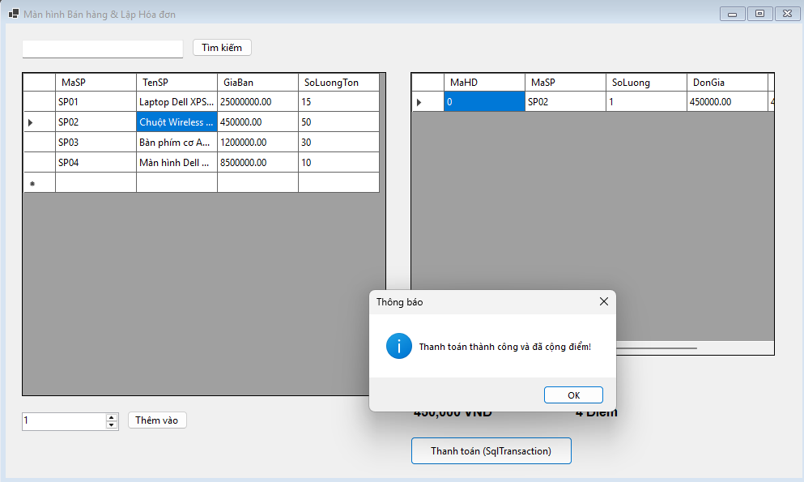
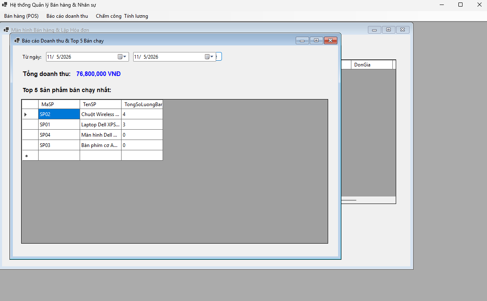
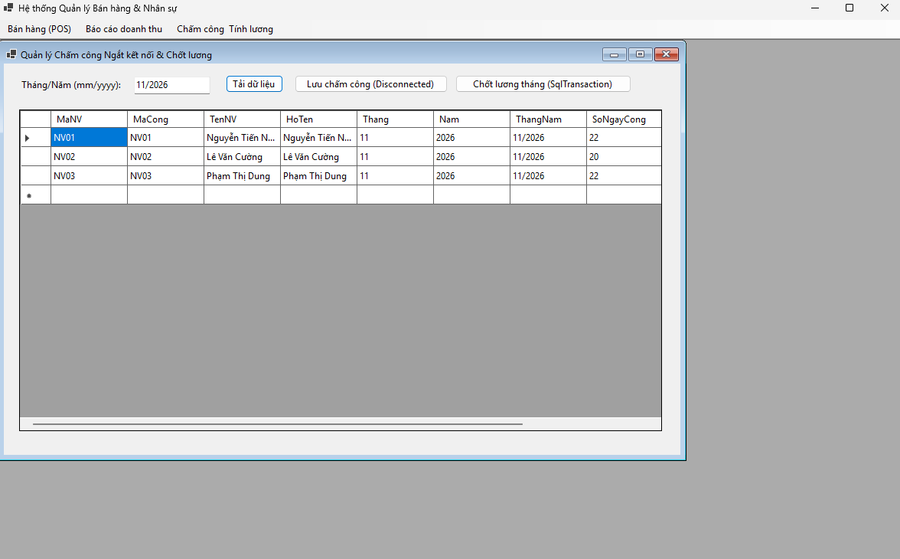

# BÁO CÁO BÀI KIỂM TRA SỐ 6 - HỆ THỐNG QUẢN LÝ BÁN HÀNG & NHÂN SỰ (.NET WINFORMS)

## 👤 THÔNG TIN SINH VIÊN

- **Họ và tên:** Nguyễn Tiến Nhật Minh
- **Mã số sinh viên:** 24810320038
- **Tên Repository:** LTNET_BAI6_24810320038_NguyenTienNhatMinh
- **Tài khoản GitHub:** minhntn24810320038-hash
- **Quyền truy cập:** Public

---

## 📁 CẤU TRÚC THƯ MỤC DỰ ÁN

```text
LTNET_BAI6_24810320038_NguyenTienNhatMinh/
├── .gitignore
├── README.md
├── Program.cs
├── hoccsharp.csproj
├── BUS/
├── DAL/
├── DTO/
└── GUI/
```

🚀 MÔ TẢ KỸ THUẬT & KIẾN TRÚC HỆ THỐNG

1. Kiến trúc 3-Tier (DTO - DAL - BUS - GUI)
   DTO (Data Transfer Object): Chứa các lớp ánh xạ dữ liệu bảng trong SQL Server.

DAL (Data Access Layer): Thực thi truy vấn T-SQL. Phòng chống 100% SQL Injection bằng SqlParameter.

BUS (Business Logic Layer): Kiểm tra quy tắc nghiệp vụ, tính toán điểm tích lũy, tính lương.

GUI (Graphical User Interface): Màn hình WinForms tương tác người dùng.

2. Xử lý Giao dịch an toàn dữ liệu (SqlTransaction - ACID)
   Áp dụng tại màn hình lập hóa đơn bán hàng và chốt lương:

Tự động hóa thanh toán: Chèn HoaDon -> Chèn ChiTietHoaDon -> Trừ SoLuongTon sản phẩm -> Cộng DiemTichLuy khách hàng.

Kiểm soát thất bại: Nếu SoLuongTon < SoLuong mua -> Gọi trans.Rollback() và thông báo lỗi.

Commit: Gọi trans.Commit() khi tất cả các bước thành công 100%.

3. Mô hình Ngắt kết nối (Disconnected Model)
   Áp dụng tại module Chấm công hàng tháng (HRMDB):

Sử dụng SqlDataAdapter nạp dữ liệu nhân viên vào DataTable hiển thị lên DataGridView.

Cho phép người dùng chỉnh sửa trực tiếp số ngày công và giờ OT trên lưới.

Sử dụng SqlCommandBuilder kết hợp adapter.Update(dt) để đồng bộ dữ liệu chấm công về SQL Server trong 1 thao tác.
## 🖼️ HÌNH ẢNH MINH CHỨNG GIAO DIỆN HỆ THỐNG

---

### 1. Màn hình Bán hàng (POS) & Thanh toán SqlTransaction
> **Ghi chú:** Giao diện lập hóa đơn bán hàng, tự động tính tiền, trừ số lượng tồn kho và cộng điểm tích lũy khách hàng bằng giao dịch an toàn dữ liệu `SqlTransaction`.



<br>

---

### 2. Màn hình Báo cáo Doanh thu & Top 5 Bán chạy
> **Ghi chú:** Thống kê tổng doanh thu chuẩn xác theo từng mốc thời gian và hiển thị danh sách 5 sản phẩm bán chạy nhất hệ thống.



<br>

---

### 3. Màn hình Quản lý Chấm công & Chốt lương (Disconnected Model)
> **Ghi chú:** Sử dụng mô hình ngắt kết nối `SqlDataAdapter` để tải danh sách nhân viên lên `DataGridView`, cho phép chỉnh sửa ngày công, giờ OT trực tiếp trên lưới và chốt lương hàng tháng.



<br>

